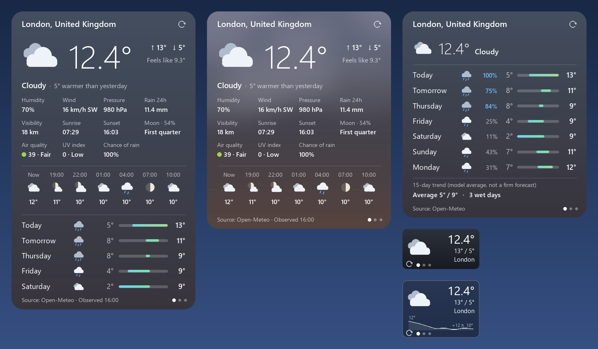
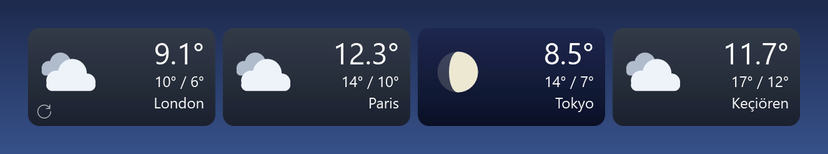
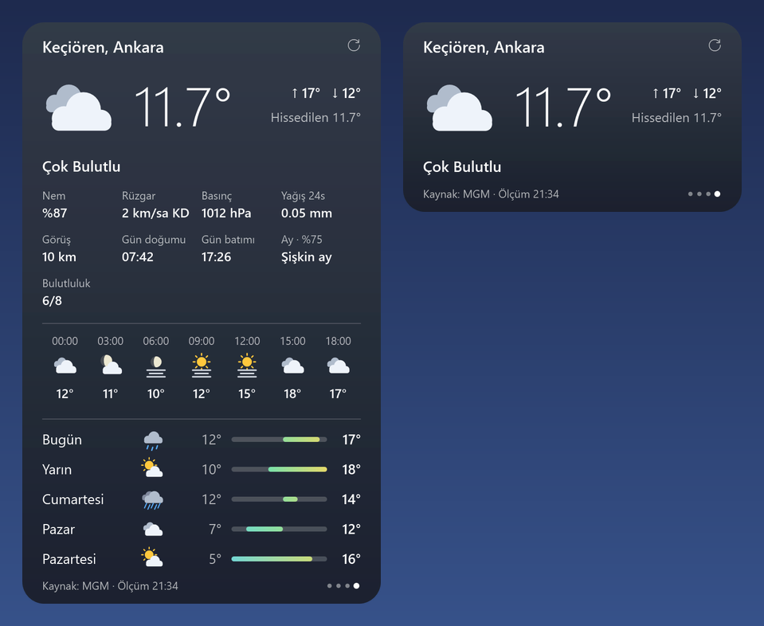

  

<h1 align="center">Cumulo</h1>

  A weather widget for the Windows 10/11 desktop · Windows masaüstü için hava durumu widget'ı 
  <a href="../../releases/latest"><b>Download / İndir</b></a> · <a href="#türkçe">Türkçe</a>

## Download

Get **`HavaDurumu-Kurulum.exe`** from the [latest release](../../releases/latest) and run it.

- Installs for your user only, no administrator rights needed.
- Adds Cumulo to the Start menu; uninstall it from **Settings > Apps**.
- Updates itself: new versions are downloaded and installed from inside the app.

The installer is not code-signed, so Windows SmartScreen may warn on first run
(**More info > Run anyway**).

## Features

- Current conditions, hourly forecast, 5-day forecast, and a weekly view with a 16-day trend
- Any city in the world (Open-Meteo); Turkish provinces and districts use official MGM data
- Several cities with automatic cycling, and extra widgets for other cities or screens
- Layouts from a tiny icon + temperature card up to the full forecast, plus side-by-side and stacked city rows
- Themes: match the weather, illustrated scene, dark, light, glass, transparent, follow Windows, custom color or your own image
- Notifications: rain on the way, temperature thresholds, very high UV, morning summary, umbrella/coat reminders, quiet hours
- Air quality, UV index, pollen, sunrise/sunset and moon phase
- MGM weather warnings and radar for Turkey
- Tray icon with the current temperature, a hotkey to bring the widget forward, click-through mode
- °C / °F, km/h / m/s, English and Turkish interface (follows your Windows language)
- Settings export and import

## Usage

Right-click the widget or the tray icon to open the menu. Drag with the left mouse button to move it.
Change the language under **Widgets and settings > Dil / Language**.

## Data sources

- [Open-Meteo](https://open-meteo.com) for forecasts worldwide, air quality and pollen
- [Turkish State Meteorological Service (MGM)](https://www.mgm.gov.tr) for locations in Turkey

Cumulo is not an official product of Open-Meteo or MGM.

---

## Türkçe

### İndirme

[Son sürüm](../../releases/latest) sayfasından **`HavaDurumu-Kurulum.exe`** dosyasını indirip çalıştırın.

- Yalnızca sizin kullanıcınıza kurulur, yönetici izni gerekmez.
- Başlat menüsüne eklenir; **Ayarlar > Uygulamalar** bölümünden kaldırılabilir.
- Kendini günceller: yeni sürümler uygulama içinden indirilip kurulur.

Kurulum dosyası imzalı olmadığı için Windows SmartScreen ilk açılışta uyarı gösterebilir
(**Ek bilgi > Yine de çalıştır**).

### Özellikler

- Anlık durum, saatlik ve 5 günlük tahmin, 16 günlük eğilimli haftalık görünüm
- Türkiye'deki il ve ilçeler için MGM verileri, uyarıları ve radarı; dünyadaki her şehir için Open-Meteo
- Birden çok şehir ve şehirler arasında otomatik geçiş; başka şehir ya da ekran için ek widget'lar
- Mikro karttan tam tahmine kadar düzenler, şehirleri yan yana ya da alt alta gösterme
- Temalar: havaya göre, çizimli sahne, koyu, açık, cam, saydam, Windows temasını izle, özel renk ya da kendi görseliniz
- Bildirimler: yaklaşan yağış, sıcaklık eşikleri, çok yüksek UV, sabah özeti, şemsiye / mont hatırlatması, sessiz saatler
- Hava kalitesi, UV indeksi, polen, gün doğumu / batımı ve ay evresi
- Sistem tepsisinde sıcaklık ikonu, öne getirme kısayol tuşu, tıklamayı geçirme
- °C / °F, km/sa / m/sn, Türkçe ve İngilizce arayüz (Windows diline göre seçilir)
- Ayarları dışa ve içe aktarma

### Kullanım

Widget'a ya da tepsi ikonuna sağ tıklayınca menü açılır. Sol tuşla sürükleyerek taşınır.
Dili **Widget'lar ve ayarlar > Dil / Language** bölümünden değiştirebilirsiniz.

### Veri kaynakları

- [Meteoroloji Genel Müdürlüğü (MGM)](https://www.mgm.gov.tr): Türkiye'deki konumlar
- [Open-Meteo](https://open-meteo.com): dünya geneli tahmin, hava kalitesi ve polen

Cumulo, MGM'nin ya da Open-Meteo'nun resmi bir ürünü değildir.
